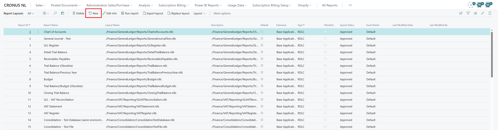
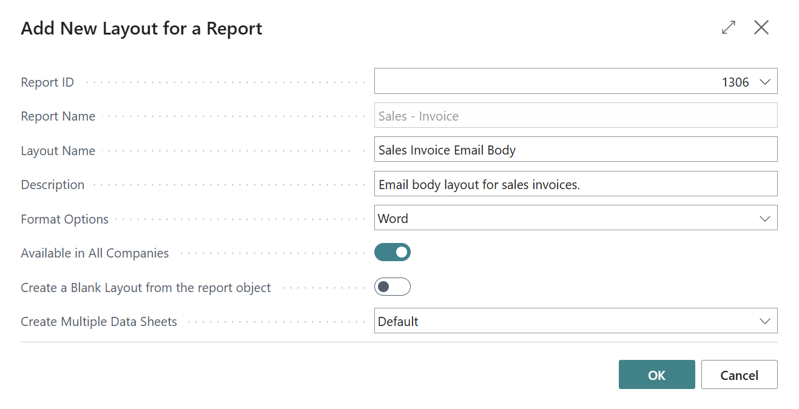
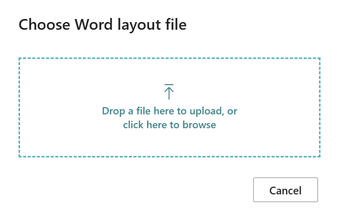
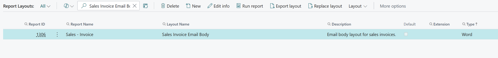
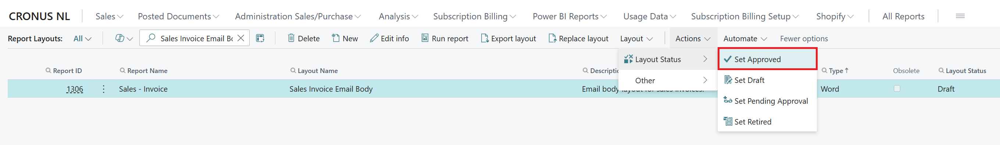
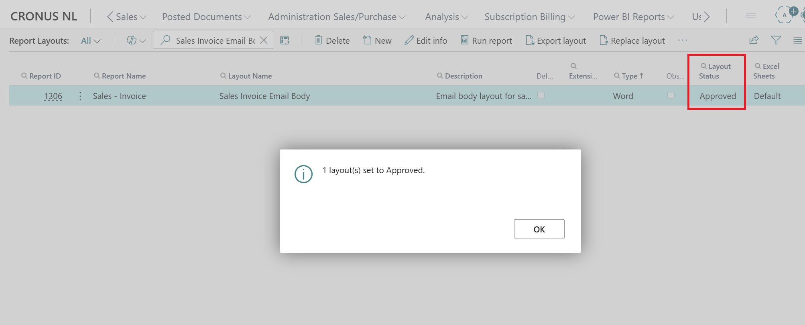
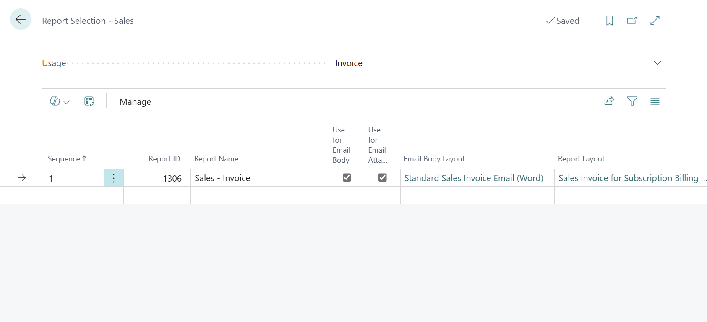
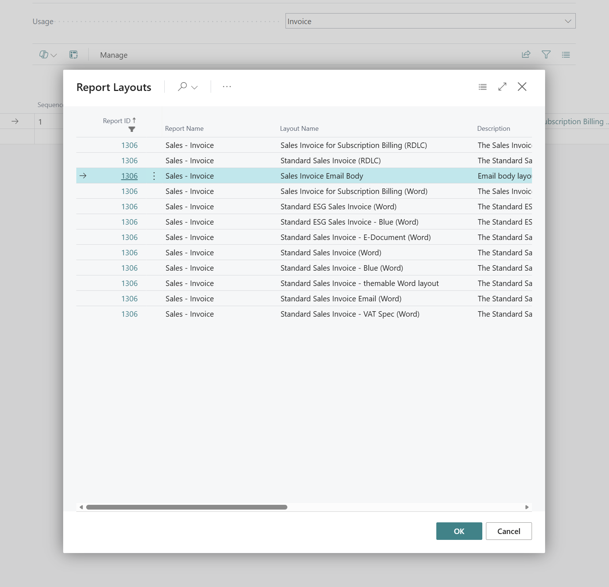

# Configuration

This page describes all configuration options for the Q-Team Solutions Edit in Outlook app in Microsoft Dynamics 365 Business Central.

## Setup Page

### Access Configuration
1. **Search for "Edit in Outlook Setup"** in Business Central
2. **Open the setup page**
3. **Configure settings** according to organizational needs

### Basic Settings

#### Main Config Tab
| Field | Description | Default | Notes |
|-------|-------------|---------|-------|
| **Enable Edit in Outlook** | Enable/disable functionality | `Yes` | Master switch for all functionality |
| **Show in Email Dialog** | Show option in email dialog | `Yes` | Determines visibility of option |
| **Default Template Code** | Default template for new emails | `''` | Leave blank for system default |
| **Enable PDF Preview** | PDF preview in browser | `Yes` | Requires PDF viewer component |
| **Allow Custom Templates** | Users may create own templates | `No` | Security consideration |

#### Advanced Settings
| Field | Description | Default | Notes |
|-------|-------------|---------|-------|
| **Debug Mode** | Extended logging | `No` | For troubleshooting only |
| **Max File Size (MB)** | Maximum size of EML files | `25` | Browser/email client limits |
| **Session Timeout (Min)** | Control add-in timeout | `30` | Browser session management |
| **Enable Telemetry** | Analytics data collection | `Yes` | For support and improvement |

## Email Template Configuration

### Template Management
Edit in Outlook uses standard Business Central email templates with extensions.

#### Template Types
1. **Sales Document Templates**
   - Sales Quotes
   - Sales Orders  
   - Sales Invoices
   - Sales Credit Memos

2. **Purchase Document Templates**
   - Purchase Quotes
   - Purchase Orders
   - Purchase Invoices
   - Purchase Credit Memos

3. **Custom Templates**
   - User-defined templates
   - Department-specific templates
   - Customer-specific layouts

### Adding an Email Layout

Business Central allows users to configure custom email layouts for different document types. These layouts determine the content and formatting of the email body when sending documents using Edit in Outlook.

The following instructions explain how to **add an existing Word email layout** and configure it for use in Business Central.

> **Note:** This guide covers adding and configuring an existing layout to Business Central. For instructions on creating or modifying layouts in Microsoft Word, see Microsoft's documentation: [Work with Word layouts](https://learn.microsoft.com/nl-nl/dynamics365/business-central/ui-how-add-fields-word-report-layout).

#### Step 1: Open Report Layouts

1. Open Microsoft Dynamics 365 Business Central.
2. Select the search icon (Alt + Q).
3. Search and open the **Report Layouts** page.
4. Select **New** to add a layout.



#### Step 2: Import the Existing Layout

The **Add New Layout for a Report** window opens.

1. Fill in the following fields:
   * **Report ID:** Determine and select the report ID associated with the document type. i.e. `1306` for Sales - Invoice.
   * **Layout Name:** Enter a recognizable name for your layout.
   * **Description:** (Optional) provide a description.
   * **Format Options:** Select `Word`.
   * **Subtype:** If available, use `Default` for a standalone Word layout.
   * **Available in All Companies:** Enable this option if the layout should be available across all companies.
2. Leave **Create a blank layout from the report object** disabled because we will upload the layout ourselves.
3. Select **OK**.



4. A window will open prompting you to browse to the existing `.docx` layout file.



5. Select the file and upload it. The layout should now be added to Business Central.
6. Find the newly imported layout on the **Report Layouts** page.



7. Select the layout and choose Validate to check for potential issues.
8. The layout initially has the status **Draft**, select **Actions → Layout Status → Set Approved** to make it available for selection.



9. Verify that the layout has the status **Approved** instead of **Draft**.




> **Important:** An email body layout must use the Word format (`.docx`) and must be compatible with the dataset of the selected report. RDLC layouts cannot be used as email body layouts.

#### Step 3: Assign the Email Layout to a Document Type
After importing the layout, configure which document type should use it.

1. Open the search function (Alt + Q).
2. Search for **Report Selections** and open the page corresponding to the document type you want to configure.
   For example:
   * **Report Selections - Sales:** For sales documents.
   * **Report Selections - Purchase:** For purchase documents.
   * **Report Selections - Warehouse:** For warehouse documents.
   * **Report Selections - Service:** For service documents.
> **Note:** The available configuration options may differ between Report Selections pages. Not all document types support email body layouts.
3. For this example, open **Report Selections - Sales**.



4. In the **Usage** field, select the document type you want to configure.
   For example:
   * `Quote` for sales quotes.
   * `Order` for sales orders.
   * `Invoice` for sales invoices.
   * `Credit Memo` for sales credit memos.
5. Verify that the **Report ID** matches the report used when importing the layout.
6. Confirm that **Use for Email Body** is enabled.
7. Select the **Email Body Layout** field and choose your imported report layout.



The selected layout will now be used to generate the email body for the configured document type.

> **Note:** The email body layout and the document attachment layout are configured separately. Changing the email body layout does not automatically change the PDF attachment.
> **Note:** Customer- or vendor-specific layouts may override the general report selection. If the expected email layout is not applied, you should check the Document Layouts configuration on the relevant Customer or Vendor Card.
For purchase documents, follow the same procedure using **Report Selections - Purchase**.

> **Note — QTEAM Shipment Email Body:** The **QTEAM Shipment Email Body** layout (`SalesShipmentEmail.docx`) is a custom Word layout added to the standard Sales - Shipment report (Report 208). It is used to generate the email body for shipment confirmations in Edit in Outlook.
>
> To configure it, open **Report Selections - Sales**, select the appropriate shipment Usage, and choose **QTEAM Shipment Email Body** in the **Email Body Layout** field.

#### Step 4: Test the Email Layout

After configuring the email layout, verify that it works correctly.

1. Open a document of the configured type, such as a sales invoice.
2. Select the **Edit in Outlook** action.
3. Open the generated email in Outlook.
4. Verify that:
   * The configured email body layout is applied.
   * Document information is displayed correctly.
   * The formatting is correct.
   * The expected PDF attachment is included, if applicable.


### Additional Information

For more information, refer to the following Microsoft Learn articles:

* **[Work with Word layouts](https://learn.microsoft.com/nl-nl/dynamics365/business-central/ui-how-add-fields-word-report-layout):** Instructions for creating and modifying Word layouts.

* **[Get started creating report layouts](https://learn.microsoft.com/en-us/dynamics365/business-central/ui-get-started-layouts):** Instructions for importing, managing, and replacing layouts.

* **[Set up email in Business Central](https://learn.microsoft.com/en-us/dynamics365/business-central/admin-how-setup-email#set-up-reusable-email-texts-and-layouts):** Instructions for configuring reusable email texts and layouts.

* **[Define document layouts for customers and vendors](https://learn.microsoft.com/en-us/dynamics365/business-central/ui-define-customer-vendor-document-layouts):** Instructions for assigning specific layouts to business partners.


## Document Type Configuration

### Report Selection Setup

The process for configuring document attachment layouts is similar to configuring email body layouts.

For instructions on importing and approving a layout, follow **[Adding an Email Layout](#adding-an-email-layout)**, specifically Steps 1 and 2.

> **Note:** Unlike email body layouts, document attachment layouts can use other supported formats, such as RDLC, in addition to Word.

1. Open the appropriate **Report Selections** page, such as **Report Selections - Sales** or **Report Selections - Purchase**.
2. In the **Usage** field, select the document type you want to configure.
3. Verify that the **Report ID** matches the report associated with your imported layout.
4. Enable **Use for Email Attachment**.
5. Select the **Report Layout** field and choose your desired layout.
6. Test the configuration using **Edit in Outlook** to verify that the correct document is attached.


## User Permissions Configuration

### Permission Sets
The app contains various permission sets:

#### QTEAM EIO USER
**For**: End users
**Rights**:
- Read email templates
- Use Edit in Outlook functionality  
- Download EML files
- Basic document access

#### QTEAM EIO ADMIN
**For**: App administrators
**Rights**:
- All USER rights
- Configuration of setup page
- Template management
- Debug functionality
- User management

#### QTEAM EIO DEVELOPER
**For**: Developers/consultants
**Rights**:  
- All ADMIN rights
- Access to Integration Events
- Extensibility debugging
- Advanced telemetry

### User Assignment
Assign correct rights per user group:
```al
// Example: Bulk assignment via AL code
UserPermissionSets.SetRange("User ID", UserId);
UserPermissionSets.SetRange("Permission Set ID", 'QTEAM EIO USER');
if not UserPermissionSets.FindFirst() then begin
    UserPermissionSets.Init();
    UserPermissionSets."User ID" := UserId;
    UserPermissionSets."Permission Set ID" := 'QTEAM EIO USER';
    UserPermissionSets.Insert();
end;
```

## Environment-Specific Configuration

### Development Environment
For development environments:
```json
{
    "debugMode": true,
    "telemetryEnabled": false,
    "maxFileSizeMB": 10,
    "sessionTimeoutMin": 60
}
```

### Production Environment  
For production environments:
```json
{
    "debugMode": false,
    "telemetryEnabled": true,
    "maxFileSizeMB": 25,
    "sessionTimeoutMin": 30
}
```

### Test Environment
For test environments:
```json
{  
    "debugMode": true,
    "telemetryEnabled": true,
    "maxFileSizeMB": 50,
    "sessionTimeoutMin": 45
}
```

## Performance Configuration

### Browser Optimization
For better performance:

#### Control Add-in Settings
- **Lazy Loading**: Control add-ins load only when needed
- **Memory Management**: Automatic cleanup after use
- **Caching**: Template caching for faster loading

#### JavaScript Optimization
```javascript
// Browser detection and optimization
const browserConfig = {
    chrome: { 
        maxConcurrentDownloads: 5,
        memoryLimit: '100MB'
    },
    edge: { 
        maxConcurrentDownloads: 3,
        memoryLimit: '80MB'  
    },
    firefox: {
        maxConcurrentDownloads: 4,
        memoryLimit: '90MB'
    }
};
```

### Server Optimization
For Business Central server performance:

#### Codeunit Optimization
```al
// Example: Using temporary records for performance
TempEmailItem.DeleteAll();
EmailItem.SetRange("Document Type", DocumentType);
EmailItem.SetRange("Document No.", DocumentNo);
if EmailItem.FindSet() then
    repeat
        TempEmailItem := EmailItem;
        TempEmailItem.Insert();
    until EmailItem.Next() = 0;
```

## Security Configuration

### Data Protection
- **Personal Data**: GDPR compliance settings
- **Audit Trail**: Logging of email activity
- **Data Retention**: Automatic cleanup of temporary files

### Access Control
- **IP Restrictions**: Limit access to specific IP ranges
- **User Restrictions**: Limit functionality per user group  
- **Document Restrictions**: Limit access to specific document types

---

**Next steps:**
- [Editing emails](../usage/editing-emails.md) - Start using
- [API Overview](../integration/api-overview.md) - Integration possibilities
- [Common Errors](../troubleshooting/common-errors.md) - Problem solving


---


#### Template Configuratie Stappen
1. **Ga naar Email Templates** in Business Central
2. **Selecteer relevant template**
3. **Edit template content**:
   ```html
   <!DOCTYPE html>
   <html>
   <head>
       <title>%1</title> <!-- Document Type -->
   </head>
   <body>
       <h1>%2</h1>     <!-- Company Name -->
       <p>Dear %3,</p> <!-- Customer Name -->
       
       <p>Please find attached %4.</p> <!-- Document Description -->
       
       <p>Best regards,<br/>
       %5</p>          <!-- User Name -->
   </body>
   </html>
   ```

### Template Variabelen
Ondersteunde placeholders in templates:

| Variabele | Beschrijving | Gebruik |
|-----------|--------------|---------|
| `%1` | Document Type | Sales Quote, Invoice, etc. |
| `%2` | Company Name | Naam van bedrijf |
| `%3` | Customer/Vendor Name | Ontvanger naam |
| `%4` | Document Description | "Sales Quote No. SQ001" |
| `%5` | User Name | Naam van verzender |
| `%6` | Document Date | Datum van document |
| `%7` | Due Date | Vervaldatum (waar relevant) |
| `%8` | Amount | Totaalbedrag |
| `%9` | Currency Code | Valuta code |
| `%10` | Custom Field 1 | Configureerbaar veld |

## Document Type Configuratie

### Report Selection Setup
Configureer welke rapporten gebruikt worden voor elk documenttype:

#### Sales Documents
1. **Ga naar Report Selection - Sales**
2. **Configureer voor elke Usage**:
   - `Email Body`: Template voor e-mail body
   - `Email Attachment`: PDF rapport voor bijlage
   - `Email Layout`: Layout specifieke instellingen

#### Purchase Documents  
1. **Ga naar Report Selection - Purchase**
2. **Configureer analoog aan Sales**

#### Warehouse Documents
1. **Ga naar Report Selection - Warehouse**
2. **Configureer shipment templates**

### Document Layout Options
| Document Type | Standaard Rapport | Layout Opties |
|---------------|------------------|---------------|
| Sales Quote | Report 1304 | Standard, Detailed, Simple |
| Sales Order | Report 1305 | Standard, Packing Slip |
| Sales Invoice | Report 1306 | Standard, Detailed, Pro Forma |
| Sales - Shipment | Report 208 | Standard, QTEAM Shipment Email Body |
| Purchase Order | Report 405 | Standard, Simplified |
| Warehouse Shipment | Report 5795 | Standard, Compact |

> **Opmerking — Sales - Shipment aangepaste layout**: De **QTEAM Shipment Email Body** layout is een aangepaste Word layout (`SalesShipmentEmail.docx`) toegevoegd via een report extension aan het standaard Sales - Shipment rapport. Deze wordt gebruikt als e-mail body bij het verzenden van verzendbevestigingen via Edit in Outlook (Report Selection Usage: `S.Shipment`). Om deze te activeren, ga naar **Report Selection - Sales**, stel Usage in op **Shipment** en selecteer de **QTEAM Shipment Email Body** layout.

## Gebruikersrechten Configuratie

### Permission Sets
De app bevat verschillende permission sets:

#### QTEAM EIO USER
**Voor**: Eindgebruikers
**Rechten**:
- Lezen van e-mail templates
- Gebruik van Edit in Outlook functionaliteit  
- Download van EML bestanden
- Basis document toegang

#### QTEAM EIO ADMIN
**Voor**: App beheerders
**Rechten**:
- Alle USER rechten
- Configuratie van setup pagina
- Template management
- Debug functionaliteit
- Gebruiker management

#### QTEAM EIO DEVELOPER
**Voor**: Ontwikkelaars/consultants
**Rechten**:  
- Alle ADMIN rechten
- Toegang tot Integration Events
- Extensibility debugging
- Advanced telemetry

### User Assignment
Wijs juiste rechten toe per gebruikersgroep:
```al
// Voorbeeld: Bulk toewijzing via AL code
UserPermissionSets.SetRange("User ID", UserId);
UserPermissionSets.SetRange("Permission Set ID", 'QTEAM EIO USER');
if not UserPermissionSets.FindFirst() then begin
    UserPermissionSets.Init();
    UserPermissionSets."User ID" := UserId;
    UserPermissionSets."Permission Set ID" := 'QTEAM EIO USER';
    UserPermissionSets.Insert();
end;
```

## Miljøspecifieke Configuratie

### Development Environment
Voor ontwikkelomgevingen:
```json
{
    "debugMode": true,
    "telemetryEnabled": false,
    "maxFileSizeMB": 10,
    "sessionTimeoutMin": 60
}
```

### Production Environment  
Voor productieomgevingen:
```json
{
    "debugMode": false,
    "telemetryEnabled": true,
    "maxFileSizeMB": 25,
    "sessionTimeoutMin": 30
}
```

### Test Environment
Voor testomgevingen:
```json
{  
    "debugMode": true,
    "telemetryEnabled": true,
    "maxFileSizeMB": 50,
    "sessionTimeoutMin": 45
}
```

## Performance Configuratie

### Browser Optimalisatie
Voor betere performance:

#### Control Add-in Settings
- **Lazy Loading**: Control add-ins laden only when needed
- **Memory Management**: Automatic cleanup na gebruik
- **Caching**: Template caching voor snellere loading

#### JavaScript Optimalisatie
```javascript
// Browser detection en optimalisatie
const browserConfig = {
    chrome: { 
        maxConcurrentDownloads: 5,
        memoryLimit: '100MB'
    },
    edge: { 
        maxConcurrentDownloads: 3,
        memoryLimit: '80MB'  
    },
    firefox: {
        maxConcurrentDownloads: 4,
        memoryLimit: '90MB'
    }
};
```

### Server Optimalisatie
Voor Business Central server performance:

#### Codeunit Optimalisatie
```al
// Voorbeeld: Gebruik van temporary records voor performance
TempEmailItem.DeleteAll();
EmailItem.SetRange("Document Type", DocumentType);
EmailItem.SetRange("Document No.", DocumentNo);
if EmailItem.FindSet() then
    repeat
        TempEmailItem := EmailItem;
        TempEmailItem.Insert();
    until EmailItem.Next() = 0;
```

## Security Configuratie

### Data Protection
- **Personal Data**: GDPR compliance instellingen
- **Audit Trail**: Logging van e-mail activiteit
- **Data Retention**: Automatische cleanup van tijdelijke bestanden

### Access Control
- **IP Restrictions**: Beperken toegang tot specifieke IP ranges
- **User Restrictions**: Beperken functionaliteit per gebruikersgroep  
- **Document Restrictions**: Beperken toegang tot specifieke documenttypen

---

**Volgende stappen:**
- [E-mails bewerken](../usage/editing-emails.md) - Start met gebruiken
- [API Overzicht](../integration/api-overview.md) - Integratie mogelijkheden
- [Common Errors](../troubleshooting/common-errors.md) - Probleemoplossing